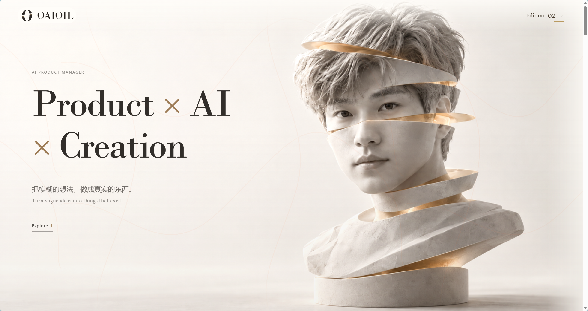

<p align="center">OAIOIL · EDITION 02</p>

<h1 align="center">Product × AI × Creation</h1>

<p align="center">把模糊的想法，做成真实的东西。<br><sub>Turn vague ideas into things that exist.</sub></p>

<p align="center">
  <a href="https://oaioil.cn/">进入个站 ↗</a> ·
  <a href="https://oaioil.cn/#portfolio">精选作品</a> ·
  <a href="https://oaioil.cn/v1/">经典版 1.0</a>
</p>

[](https://oaioil.cn/)

## 古典的质感，现代的表达

这里是张禹的个人网站：关于产品、AI、创作，也关于作为一个人的兴趣与性格。

2.0 从一座切片雕塑出发，将暖白石材、香槟金与纸张肌理，融入现代排版和交互。它既是一份作品集，也是一次与 AI 协作打磨体验的实践——由我提出方向、做产品与审美取舍，再与 AI 一起实现、检查和迭代。

### 从「我是谁」到「我做过什么」

| 章节 | 你会看到 |
| --- | --- |
| **Opening / Hero** | 雕塑开场、切片 O 标识、手写签名与滚动叙事 |
| **About me** | OAIOIL 六个字母对应的个人关键词与可探索的鎏金材质 |
| **Selected works** | 画册式作品跨页：琴窗 MeloVista、AI 落地页探索、Skills 合集 |
| **What I can do** | 旋转卡片中的产品探索、体验设计、Agent 与工作流能力 |
| **What I have done** | 从具体问题出发的项目实践与核心经历 |
| **Collaborators** | 我与 AI、设计和协作工具之间的分工 |

### 不只换一张皮肤

- **材质有层次**：雕塑与 About 保留石材、金光记忆点；后续以纸页和不同卡片质感衔接。
- **动效有节奏**：作品前后切换、能力卡片旋转、分区入场各有表达，不把每一屏都做成同一种动画。
- **移动端重新组织**：作品切换缩短位移并控制溢出，经历横向翻阅，工具采用双列与可展开详情。
- **新旧版本共存**：通过页头 Edition 选择器，在 2.0 与经典 1.0 之间切换。

## 作品入口

- [琴窗 MeloVista](https://github.com/yuzhang-ai/melovista) — 一扇窗，一架琴；把音乐兴趣做成可体验的浏览器琴房。
- **AI 落地页探索** — 围绕需求梳理、统一编辑和 AI 生成的协作方式，展示编辑器截图与探索方向。
- **Skills 合集** — 工作与个人实践中的工具、方法与复用尝试；具体内容见[个站作品区](https://oaioil.cn/#portfolio)。

## 本地运行

原生 HTML、CSS 与 JavaScript 静态站点，无需安装依赖或执行构建。

```bash
git clone --branch site-v2 https://github.com/yuzhang-ai/OAIOIL.github.io.git
cd OAIOIL.github.io
python -m http.server 4175 --bind 127.0.0.1
```

打开 <http://127.0.0.1:4175/>。使用 Python 3；系统命令为 `python3` 时相应替换。

### 代码地图

```text
index.html       页面内容与结构
css/             分层样式、材质与响应式规则（入口 main.css）
js/              开场、作品翻页、能力轮播与移动端交互
assets/          雕塑、签名、作品图与材质资源
vendor/          本地第三方依赖
scripts/         静态及模拟生命周期检查
docs/assets/     仓库展示图片
v1/              经典版归档
```

使用 Three.js 增强局部材质效果，Lenis 处理平滑滚动；页面内容不依赖后端服务。

### 检查

```bash
node scripts/check-editorial.cjs
node scripts/check-opening.cjs
```

这些检查覆盖静态结构和模拟生命周期，不替代浏览器中的视觉、触控、性能与真实设备验收。

## 版本与发布

**`site-v2` 是默认分支，也是 GitHub Pages 的发布分支。** `main` 保留经典 1.0 源码，不覆盖历史版本。

线上入口为 [oaioil.cn](https://oaioil.cn/)，经典版为 [oaioil.cn/v1/](https://oaioil.cn/v1/)。发布与回滚说明见 [VERSIONS.md](VERSIONS.md)。

## 素材与致谢

第三方组件和图标保留各自许可与来源说明：见 [SVGL](assets/SVGL-LICENSE.txt)、[AMICRO](assets/AMICRO-LICENSE.txt)，以及随依赖提供的许可证。

本仓库包含个人肖像、签名与作品展示素材；公开展示不等于授权将这些个人素材用于其他品牌或身份。

---

<p align="center"><sub>一份持续生长的个人作品集 · Made with judgment, curiosity & AI.</sub></p>
